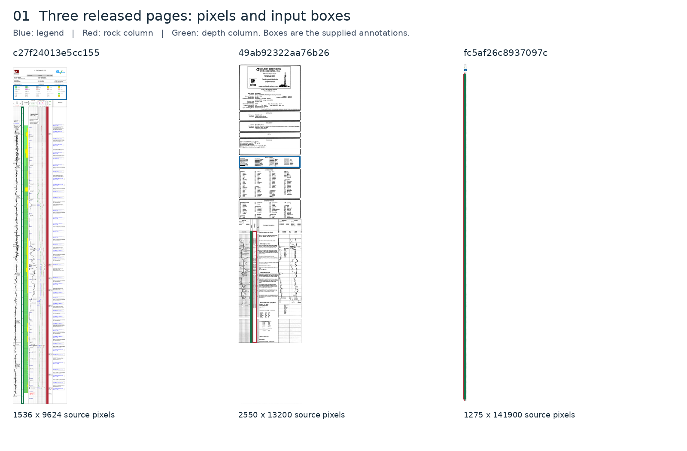
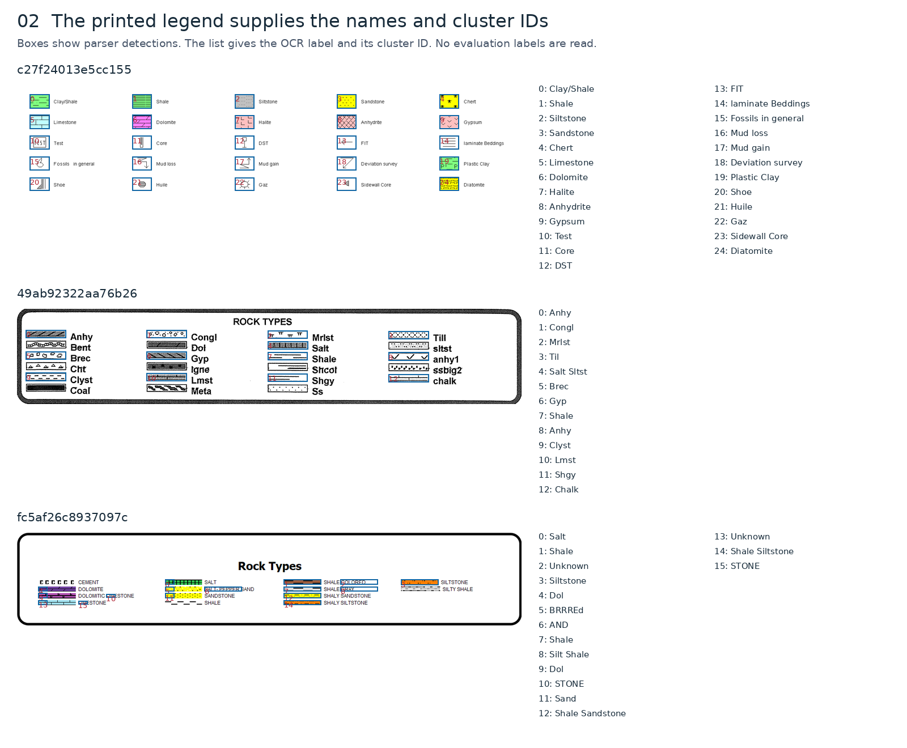
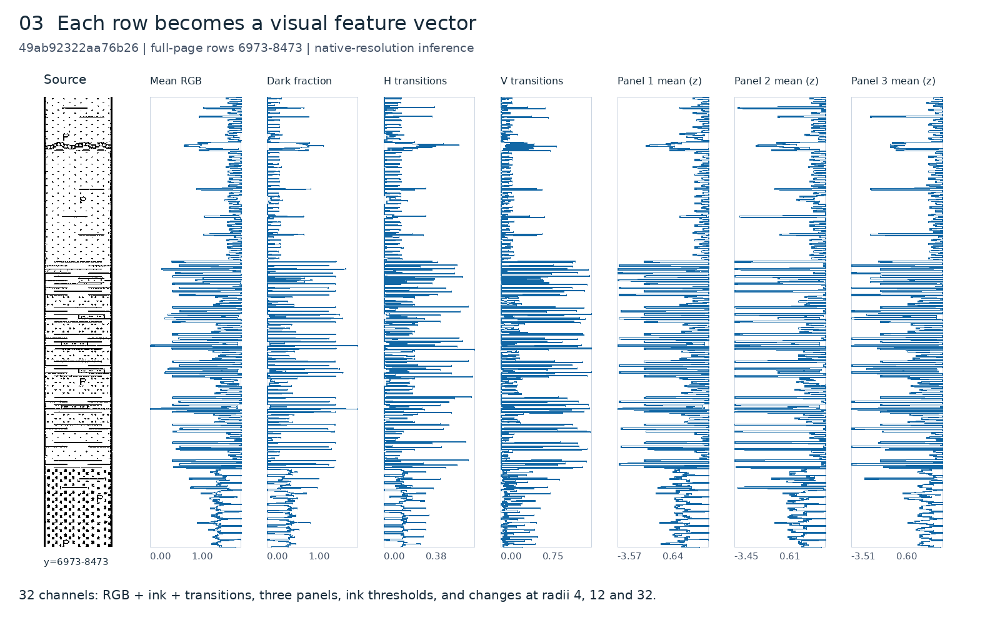
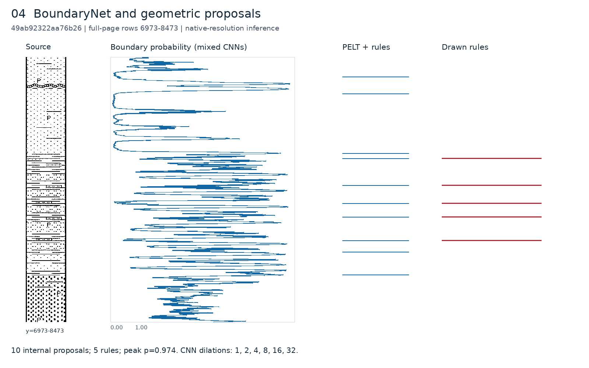
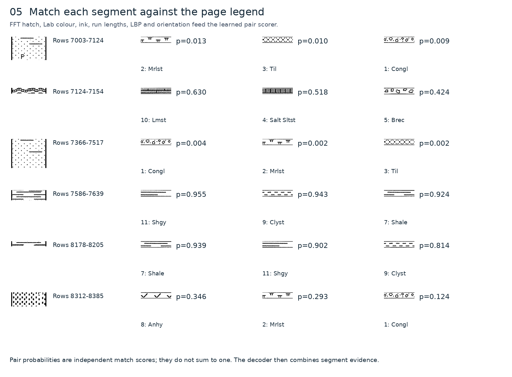
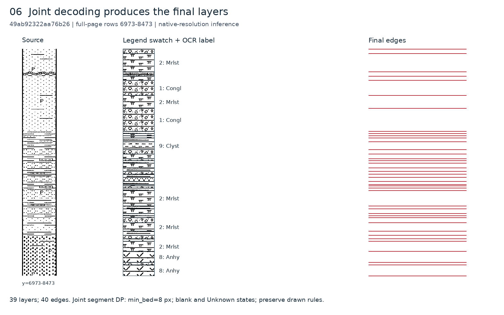
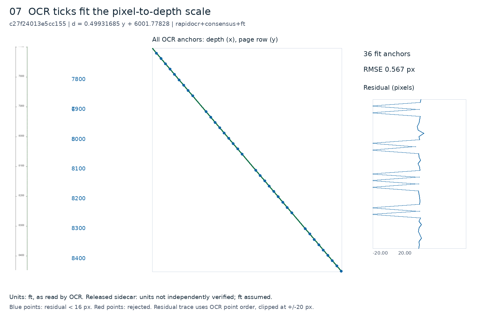
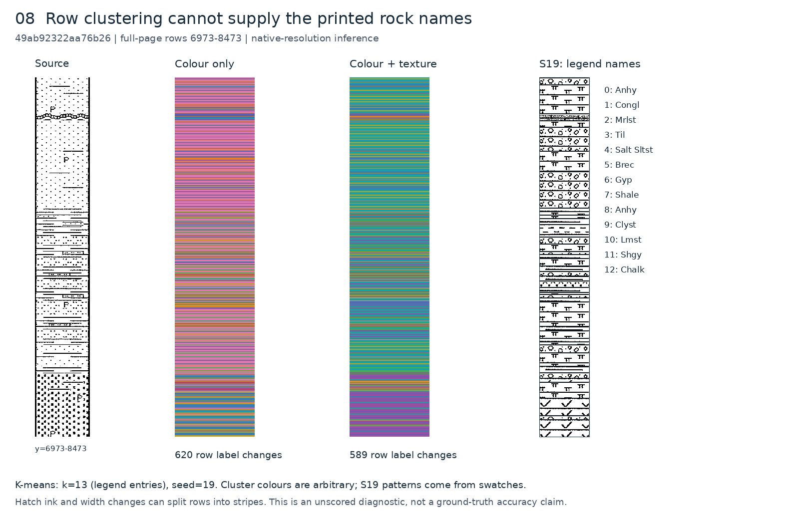

# Strata

Strata reads scanned well logs and turns the rock column into layers you can use: rock type, top and bottom depth, and where each layer sits on the page.

Built by **402_Payment_Required** for Viridien's *Decoding the Subsurface* challenge at HackTheBurgh 2026.


## The problem

A well log is a long scanned strip. The rocks found at each depth are drawn as black-and-white patterns, with a legend on the side that says which pattern is which rock. That information is useful for drilling, storage and planning decisions, but it is locked inside an image.

Strata takes the scan and produces a CSV in the challenge format:

```csv
top_depth,bottom_depth,lithology,top_y,bottom_y,cluster_id
```

## How the pipeline works (S19)

Our final model is called **S19**. The name comes from our test setup: every idea we tried became a numbered strategy (S2, S11, S14, …) and was scored on the same pages. S19 is the version that won.

The core idea is simple. **The legend is the answer key that comes with every page.** Each log prints its own legend: a small swatch for every rock pattern, with the rock's name next to it. S19 reads that legend first and then explains every part of the rock column using only those swatches. Rock names in our output are the names printed on that page, and every interval's `cluster_id` is the legend entry it matched. Nothing is guessed from other wells.

S19 takes the page image and the organisers' box file (where the legend, the rock column and the depth column are), and runs these steps.



### 1. Read the legend

The legend box is cut out and split into entries. Each entry is a swatch plus its printed label. The label is read with OCR (EasyOCR), and a small geological vocabulary (including log abbreviations such as `Ss`, `Sh` and `Lmst`) cleans up OCR slips and tells rock names apart from other legend text. We keep the page's own spelling as the output label. Each entry gets an ID, which becomes the `cluster_id` in the CSV. Results are cached by image content, so the same legend is only read once.



### 2. Describe every pixel row of the rock column

We slice the rock column into one-pixel strips and measure each one. First we trim the thick vertical border lines so they don't count as rock. Then, for each row:

- mean brightness and the fraction of dark ink,
- how often ink switches on and off across the row (horizontal hatching density),
- how often it changes from the row above (vertical structure),
- the same measurements on the left, middle and right thirds of the column, so a pattern change on one side still shows up,
- the fraction of very dark and of any ink.

Each feature is standardised for the page. We then add "change" features: the difference between the rows just above and just below, at three scales (4, 12 and 32 px). That separates a real change in rock from a single dark line inside a hatch.



### 3. Find where layers change

Three sources propose boundaries:

- **A learned boundary model.** A small 1-D convolutional network reads the row features. It has six layers with growing reach (dilations 1 to 32 rows), so it sees both fine texture and longer context. It outputs a boundary probability for every row. We trained two copies, one on synthetic logs built from our labelled patterns and one on hand-labelled real logs, and average them. It runs on a CPU and processes even very tall logs in overlapping chunks, so memory stays bounded.
- **Change-point detection (PELT)** on colour, ink and stroke-direction features. This was our first working boundary finder (strategy S2), and it is still a useful second opinion.
- **Drawn lines.** Many logs draw a horizontal rule between beds. Rows that are almost fully dark are kept as boundaries.

Proposals closer than 20 px are merged.



### 4. Match each piece to the legend

For every candidate piece of the column, and every legend swatch, S19 measures how alike they look. We use 27 comparisons, including:

- **the hatch pattern's signature:** the direction and spacing of its lines, from a Fourier transform. We normalise by the main line spacing, so a pattern printed slightly bigger or smaller still matches;
- colour (Lab histograms and medians), ink at four darkness levels, the lengths of ink and gap runs in both directions, edge direction, and local texture (LBP).

Two details matter a lot. Small swatches are **repeated like tiles at their real pixel size, never stretched** to the column width, so the pattern spacing stays true. And pages that are pure black and white are detected, and colour is dropped from the pattern comparison, since it tells you nothing there.

A small trained scorer (logistic regression) turns those 27 numbers into the probability that "this piece is this legend rock".



### 5. Decide the whole column at once

Picking the best swatch for each piece separately gives a noisy column. Instead S19 decodes the whole column together, using exact dynamic programming. It finds the sequence of layers with the lowest total mismatch, where:

- a layer must be at least 8 px tall,
- near-empty white gaps are their own "blank" state and are never forced into a rock,
- a piece that matches no swatch well is labelled `Unknown` instead of the closest wrong rock,
- drawn separator lines are kept even between two beds of the same rock, and touching beds with the same rock are otherwise merged.



### 6. Read the depth scale

OCR reads the numbers in the depth column. We fit a straight line from pixel row to depth, using pairs of readings, refitting, and ignoring readings more than 16 px off the line. We need at least three agreeing readings at different heights. If the fit looks weak, a second OCR engine (RapidOCR) re-reads three crops of the depth track and the better fit wins. We never guess units from a file name or a nearby well. If the scale can't be read, depths are left blank, never zero.



### 7. Export

Each interval becomes a CSV row in the challenge format, with `top_y`/`bottom_y` in original-image pixels, the legend label, its `cluster_id` and the two depths. We also draw an annotated full column showing boundaries, depths, labels and cluster IDs.

## Why clustering didn't work

Our first plan was unsupervised: cut the column into strips, compute features, and cluster similar strips into rocks. It failed for two reasons.

- **Black and white.** On most logs the rocks are black hatch patterns on white paper. Many patterns have almost the same amount of ink, so brightness and colour features look the same for different rocks. Clustering merged rocks that a geologist would never confuse.
- **Column width.** The rock column has a different width on every page, and patterns are printed at a fixed physical size. Strip statistics change with width and with where a strip cuts through a pattern, so one rock was split into stripes of different "clusters" while different rocks were merged.

On top of that, clusters have no names. You still need the legend to say what each cluster is.

So we turned the problem around and made the legend the centre of everything. Every page brings its own reference patterns and names, so S19 compares the column with those swatches directly, at their true pixel size, using pattern features that do not depend on colour.



## What else we tried

- **Emil's strip features.** Our first strip descriptor measured a few numbers per row: brightness, ink fraction, and horizontal and vertical ink changes, after removing the border lines. It became the base of S19's row features. S19 adds the left/middle/right panels and the multi-scale change features on top.
- **Benedek's rule-based matcher (S24).** It detects the legend and matches with hand-written visual rules plus drawn separator lines. We ported it from the notebook unchanged and scored it on the same pages. S19 scored higher, so it stayed a comparison strategy.
- **One merged Clay/Shale class.** It hid a real distinction on pages that print both. We now keep the page's own labels and only treat the two as equal when scoring.
- **A large vision model (DINOv2).** Frozen DINOv2 features helped to match some patterns, but its first call took 504 seconds against a 60-second budget per page, so it stayed out of the final path.

## How we tested it

There was no answer key, so most of our time went into building one and into a fair way to compare ideas.

### Building labelled data

1. **Hand labels.** We marked layer boundaries and rock names on a few logs by hand. This was accurate, but far too slow to cover 51 documents.
2. **AI-assisted labelling.** A model proposed labels and people checked them. Checked against our hand labels it reached 74.2% row accuracy: useful as a start, not good enough as truth.
3. **Pattern Labeller.** We built our own labelling tool. For every legend on every page, it asks for at least five examples of each pattern. That gave **82 pattern groups across 51 documents**.
4. **Synthetic logs and public data.** From the labelled patterns we generate synthetic logs with known boundaries. We also searched 72 public datasets; the Kansas Geological Survey (KGS) strip logs were the closest match to the challenge scans, so we used them to make the test set look more like real data. Synthetic logs are used for training and regression tests, never as the only proof that something works.

### A fair scoreboard

Every strategy is a plug-in with the same `predict` interface, and it is never allowed to read labels while it predicts. A shared evaluation tool runs every strategy on the same windows of the same pages and reports:

- **row accuracy:** the share of pixel rows given the right rock,
- **boundary F1:** whether boundaries land within a small tolerance of the hand-marked ones,
- macro F1 over rock types, cluster agreement (ARI) and depth error when depths exist,
- and the main **score = row accuracy × boundary F1**, so a strategy can't win by getting only one of the two right.

Runs go through CI on Windows and Linux. When a strategy loses, the tool draws the failure next to the hand labels, so we can see *where* and *why* it went wrong (below). A new version only replaced the current best after it scored higher and passed a review.


## How we built S19, step by step

| Step | Strategy | What it added | What we learned |
|---|---|---|---|
| 1 | Strip clustering | Features per strip, unsupervised groups | Fails on black-and-white hatches and changing column widths; no names |
| 2 | **S2** | Hand-made row features with PELT change points, labels from the closest legend swatch | Boundaries were usable; labels were weak |
| 3 | **S11** | Fourier hatch signatures with Lab colour for legend matching, and drawn-line boundaries | Pattern direction and spacing separate black-and-white rocks |
| 4 | **S14** | A trained scorer over 27 swatch comparisons in place of one hand-tuned distance | Better labels, and the scorer is a tiny file of numbers |
| 5 | **S19** | A learned boundary network, a better legend reader (v3), and joint decoding with blank and Unknown states | The best score on our test pages; became the final model |

Every step was scored on the same hand-checked pages using row accuracy × boundary F1, with failure pictures (see [How we tested it](#how-we-tested-it)). A new version only replaced the old one after it scored higher and passed review. The final model files are small (`pipeline/s19/models/`, four files with SHA-256 checks), run on a CPU, and never read labels during prediction.

## How the weekend went

| When (UK time) | What happened |
|---|---|
| Sat 7 Nov, 14:29 | Started with classical computer vision: strip features and change points |
| 22:10 | Pattern Labeller working |
| 22:24 | Searching public datasets for real strip logs |
| 23:23 | Synthetic log generator running |
| Sun 8 Nov, 05:35 | Scoreboard comparing strategies on the same pages |
| 08:18 | Moved runs to cloud machines to test strategies in parallel |
| 10:29 | Web app and Gemini notes joined up |
| 12:00 | Submitted with S19 |

## Results

**Released scans.** Here is the source column next to our predicted layers on the three released pages. These pages have no answer key, so this is a visual check, not an accuracy number.


## Official challenge outputs

The required outputs for the three released test documents are in [`outputs/official/`](outputs/official/): one CSV per document in the challenge header (`top_depth,bottom_depth,lithology,top_y,bottom_y,cluster_id`, file `*.official.raw.notebook.csv`), the slide variant with `base_depth` (`*.official.raw.slide.csv`), and the annotated full rock column (`*.official.full-column.png`) showing boundaries, depths, cluster IDs and lithology labels. All were produced automatically with no manual correction. Depth units were read by OCR and are marked as assumed feet, not verified.

## The Strata app

Upload a scan, see the well on a map, and click it to see its layers next to the depth scale. You can also select an area to compare the wells inside it.


The scores on the well panel (drilling ease, cost, CO₂ storage) are an early idea of where this could go. They are not validated numbers.

## Run it

You need Python 3.12, Node/npm and Make.

```sh
git clone https://github.com/NeelHaval/402Viridien.git
cd 402Viridien

# quick check on a generated example (no model download)
python scripts/local_test.py

# the app
cd demo
make setup
make run      # then open http://localhost:8000
```

To write a challenge CSV from saved predictions, see [docs/output-contract.md](docs/output-contract.md).

### The pipeline notebook

[`notebooks/pipeline_final.ipynb`](notebooks/pipeline_final.ipynb) walks through the whole pipeline step by step: load a page, segment the rock column, read the legend, classify each segment, then plot and score the result. The last sections run it on a list of pages and evaluate a batch against ground-truth label files.

### Run our model on the challenge data
Use Python 3.12 and create a virtual environment: `python -m venv .venv`.
Activate it, then run `pip install -r requirements-s19.txt`.
The four S19 model files are included in `pipeline/s19/models/`; OCR weights download on first use.
Run `python -m pipeline.run --images <provided-folder>/images --boxes <provided-folder>/bbox_annotation --out outputs/s19`.
Use the organiser folders; TIFF, PNG and JPG are accepted. CSV depths stay blank when calibration fails.
See [example output](examples/s19_output/) and [official outputs](outputs/official/).

## Repo map

| Path | What's there |
|---|---|
| `pipeline/s19/` | The S19 model: legend reader, row features, boundary network, legend matcher, joint decoder, depth fit, and the four small model files |
| `pipeline/run.py` | Runs S19 on a folder of organiser images and box files |
| `notebooks/` | The step-by-step pipeline notebook |
| `demo/` | The Strata app: FastAPI backend (upload, OCR, pipeline) and React + MapLibre frontend |
| `src/viridian402/` | Evaluation CLI, metrics, reports and model adapters |
| `scripts/challenge_export.py` | Checks saved rows and writes both challenge CSV layouts |
| `tests/`, `stress_testing/` | Test suite and stress cases |
| `docs/` | Output format, experiment guide, and how the figures were made |

## Limits

- Very thin layers, faded scans and unreadable legends can give wrong or missing layers.
- If a scan's depth scale can't be read, its layers stay in pixels. We leave the depths blank rather than guess.

See [docs/output-contract.md](docs/output-contract.md) for the CSV format and its checks.

## Credits

Team 402_Payment_Required: Silmoon Hossain ([@silmoon04](https://github.com/silmoon04)), Emil ([@emilabos](https://github.com/emilabos)), Neel Haval ([@NeelHaval](https://github.com/NeelHaval)) and Benedek Labancz ([@Benedek-Labancz](https://github.com/Benedek-Labancz)). We used AI coding tools (OpenAI Codex/GPT models and Claude) for implementation, testing and review, as the event rules require us to disclose. We built on open-source libraries including NumPy, SciPy, OpenCV, PyTorch, RapidOCR, FastAPI, React and MapLibre.
