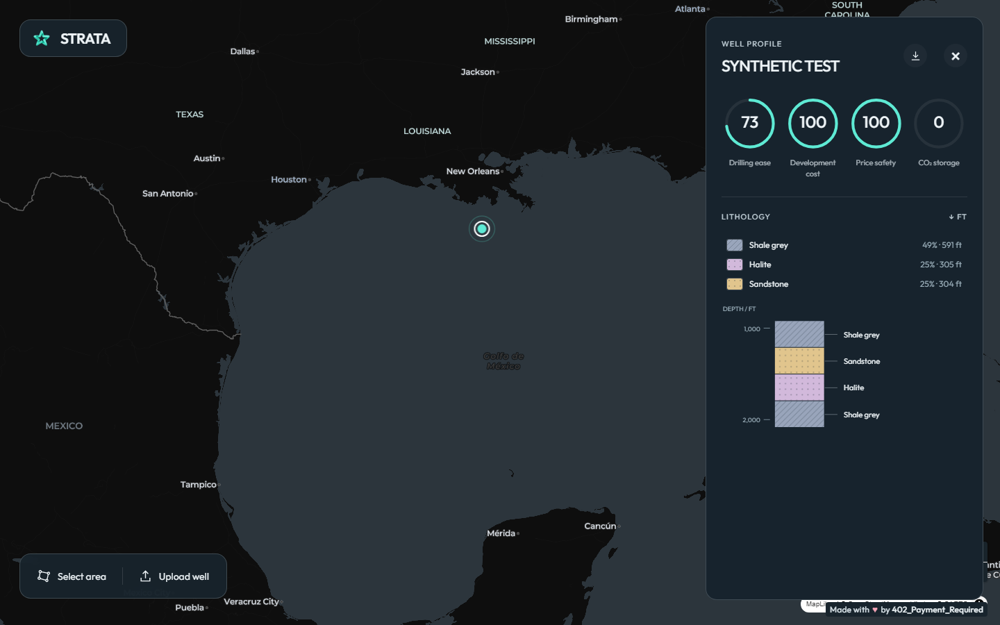
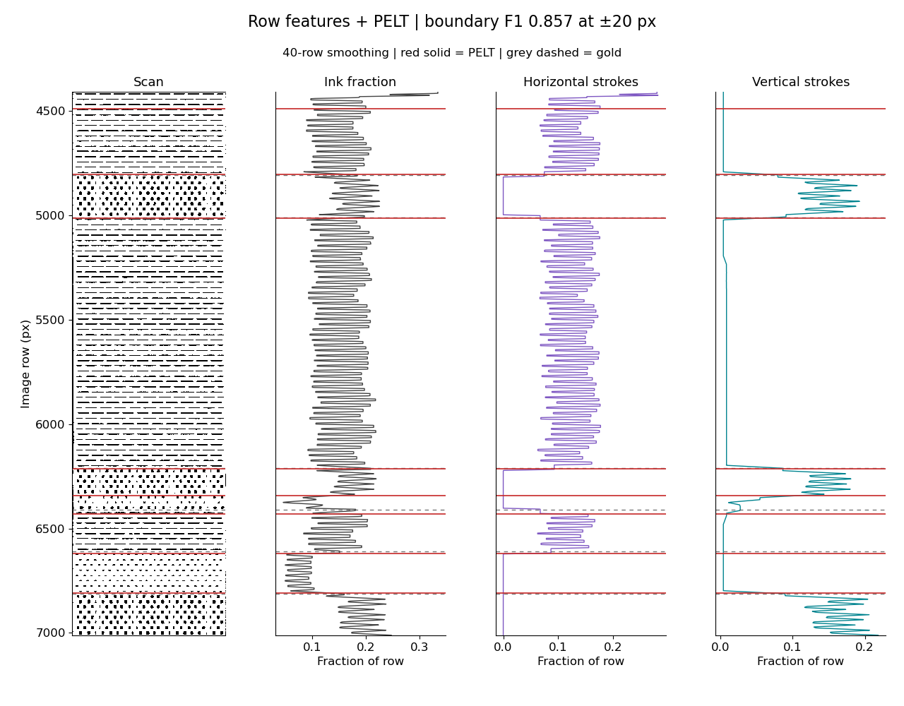
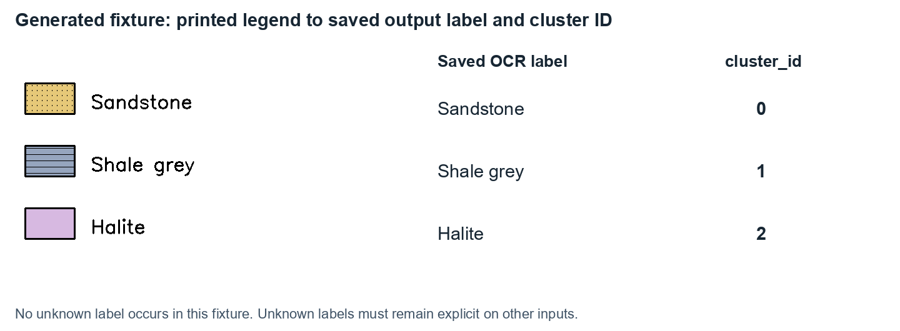
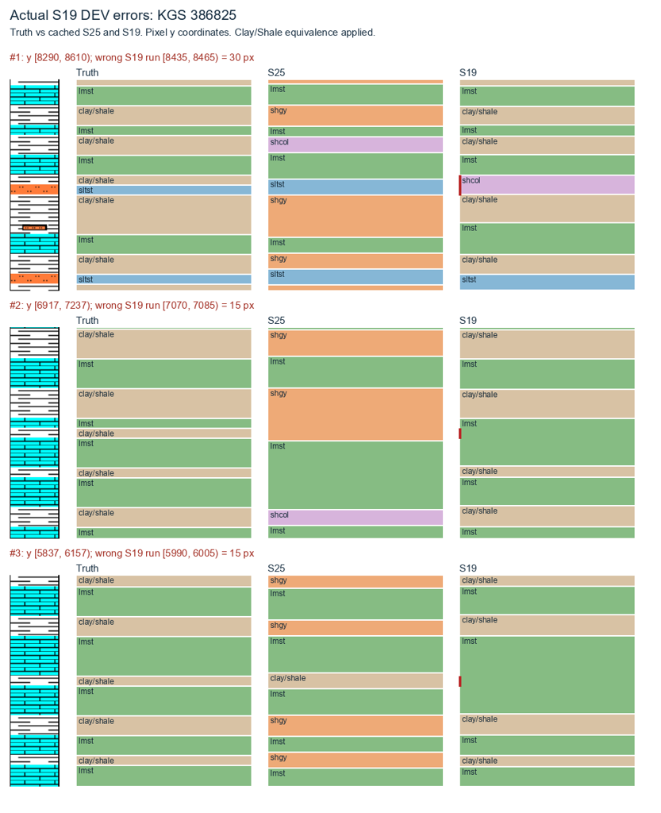
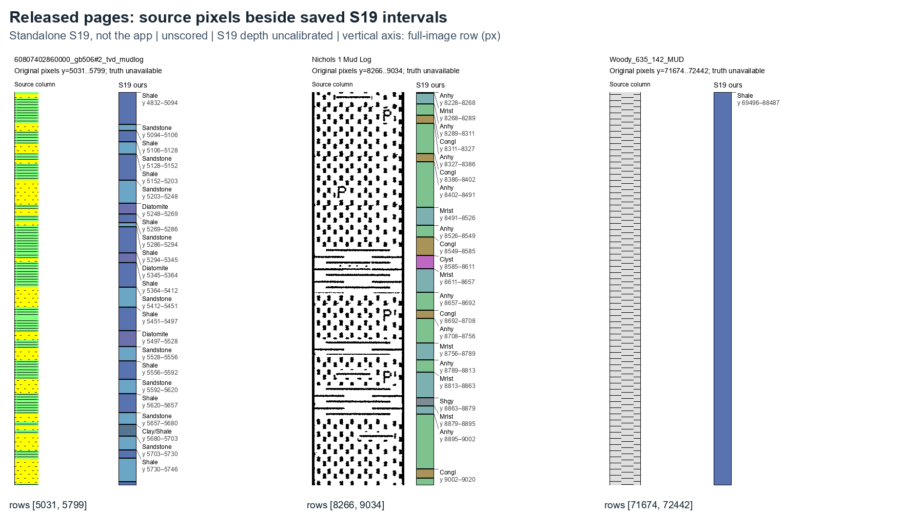
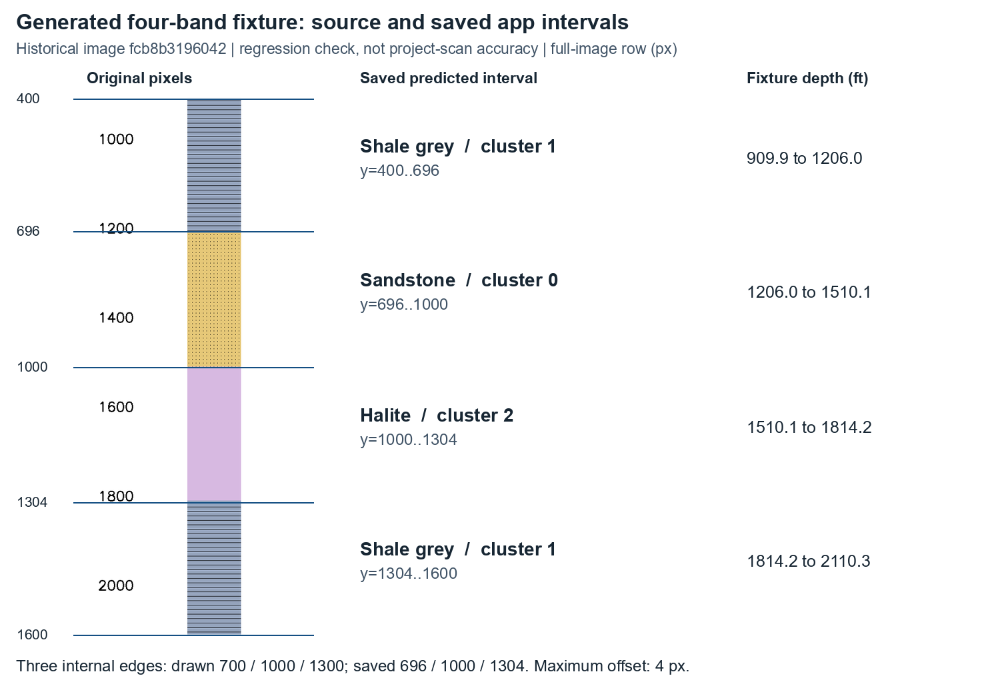
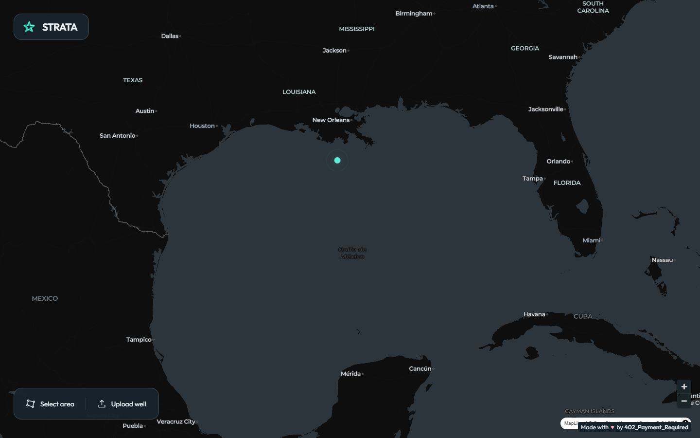
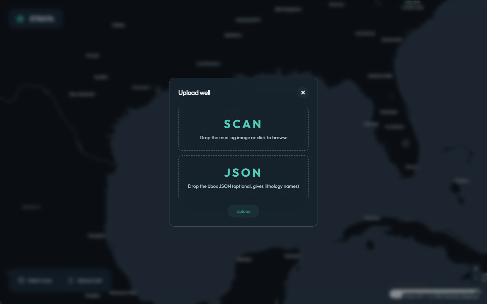

# Strata

Strata reads scanned well logs and turns the rock column into layers you can use: rock type, top and bottom depth, and where each layer sits on the page.

Built by **402_Payment_Required** for Viridien's *Decoding the Subsurface* challenge at HackTheBurgh 2026.



## The problem

A well log is a long scanned strip. The rocks found at each depth are drawn as black-and-white patterns, with a legend on the side that says which pattern is which rock. That information is useful for drilling, storage and planning decisions, but it is locked inside an image.

Strata takes the scan and produces a CSV in the challenge format:

```csv
top_depth,bottom_depth,lithology,top_y,bottom_y,cluster_id
```

## How the pipeline works

1. **Slice the rock column into thin horizontal strips.** For each strip we measure ink intensity, colour, the number of connected marks, and the spacing between them. These features were picked to tell the patterns apart.
2. **Find the boundaries.** When those features change sharply, a new layer starts. Change-point detection splits the column into segments.
3. **Match each segment to the legend.** We compute the same features for each legend swatch, then give each segment the rock type of its closest swatch.
4. **Read the depth scale and export.** OCR reads the depth ticks, rows are mapped to depths, and the layers are written as CSV plus an annotated image.



*Strip features on one log. Red lines are the boundaries we detected and grey dashed lines are hand labels. Boundary F1 is 0.857 within ±20 px on this log.*



### What we tried that didn't work

- **Clustering strips without the legend.** Grouping similar strips split a single rock into stripes, and rock-type accuracy was too low. Matching against the legend worked better.
- **One merged Clay/Shale class.** It hid a real distinction. We now keep the page's own labels and only treat the two as equivalent when scoring.
- **A large vision model (DINOv2) in the main path.** It helped on some logs, but its first call was far too slow for the time budget.

## How we tested it

Labelling by hand was slow, so we built our own test data in stages:

1. A small hand-labelled set.
2. AI-assisted labelling, checked by people.
3. **Pattern Labeller**, our own tool for marking at least five examples of every legend pattern on every page (82 pattern groups across 51 documents).
4. **Synthetic logs** generated from those labelled patterns, plus public strip logs (the closest public match was KGS) so the test set looks more like real data.

All of this lives in a shared evaluation setup with CI. Every strategy is scored on the same cases using row accuracy × boundary F1. Failures are drawn as pictures, so you can see *where* a version went wrong. A new version only replaced the current best after it scored higher and passed review.



## Results

**Released scans.** Here is the source column next to our predicted layers on the three released pages. These pages have no answer key, so this is a visual check, not an accuracy number.



**Generated scan.** On a generated four-layer log, the three predicted boundaries landed within 4 px of where they were drawn.



## The Strata app

Upload a scan, see the well on a map, and click it to see its layers next to the depth scale. You can also select an area to compare the wells inside it.

| Map | Upload |
|---|---|
|  |  |

The scores on the well panel (drilling ease, cost, CO₂ storage) are an early idea of where this could go. They are not validated numbers.

## Run it

You need Python 3.12, Node/npm and Make.

```sh
git clone https://github.com/NeelHaval/402Viridien.git
cd 402Viridien

# quick check on a generated example (no model download)
python scripts/local_test.py

# the app
cd demo
make setup
make run      # then open http://localhost:8000
```

To write a challenge CSV from saved predictions, see [docs/output-contract.md](docs/output-contract.md).

## Repo map

| Path | What's there |
|---|---|
| `demo/` | The Strata app: FastAPI backend (upload, OCR, pipeline) and React + MapLibre frontend |
| `src/viridian402/` | Evaluation CLI, metrics, reports and model adapters |
| `scripts/challenge_export.py` | Checks saved rows and writes both challenge CSV layouts |
| `tests/`, `stress_testing/` | Test suite and stress cases |
| `docs/` | Output format, experiment guide, and how the figures were made |

## Limits

- Very thin layers, faded scans and unreadable legends can give wrong or missing layers.
- If a scan's depth scale can't be read, its layers stay in pixels. We leave the depths blank rather than guess.
- The public submission packet excludes challenge scans, labels and checkpoints. This existing research repository must remain private.

See the [source status and pinned CSV checks](docs/output-contract.md) before using a submission packet.
D's combined source is still awaiting its accepted release receipt. Existing screenshots do not establish final build acceptance.

## Credits

Team 402_Payment_Required. We used AI coding tools (OpenAI Codex/GPT models and Claude) for implementation, testing and review, as the event rules require us to disclose. We built on open-source libraries including NumPy, SciPy, OpenCV, PyTorch, RapidOCR, FastAPI, React and MapLibre.
