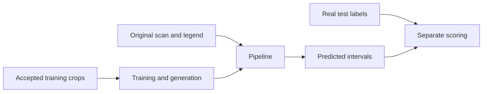

# Viridien: turn a mud-log image into labelled rock intervals

This workspace combines the pipeline, human labeller, fake-pattern generator,
outside-data tests, and review reports from the four work streams.

**Start with [START_HERE.md](START_HERE.md).** It gives setup commands and a
complete example using images and answer files already in this repository.

| Task | Guide |
| --- | --- |
| Install and run an example | [Start here](START_HERE.md) |
| Choose training, test, or review data | [Data guide](data/README.md) |
| Add or correct labels | [Labelling](docs/LABELLING.md) |
| Inspect or make fake patterns | [Generation](docs/GENERATION.md) |
| Compare a model with the baseline | [Evaluation](docs/EVALUATION.md) |
| Find what came from each work stream | [Work record](docs/WORK_RECORD.md) |
| Read confirmed issues and open work | [Status](docs/STATUS.md) |

## What goes in and comes out

Input: a scanned mud log and region boxes for its depth track, rock track, and
legend. Output: a CSV with these fields, plus an annotated image:

```text
top_depth,bottom_depth,lithology,top_y,bottom_y,cluster_id
```

Coordinates refer to the complete image. Each bed includes its top row and
excludes its bottom row. Keep native pixels when inspecting pattern spacing.



## Where the work is

| Directory | Contents |
| --- | --- |
| `bakeoff/harness/` | Image reading, legend parsing, depth fit, runner, scorer, and benchmark API |
| `bakeoff/strategies/`, `bakeoff/ml/` | Classical strategies and learned experiments through S22 |
| `pattern_lab/` | Current pattern queue, full document editor, shared saves, and exports |
| `pattern_lab/genlab/` | Tile learner, generator, realism checks, and column assembly |
| `bakeoff/labeltool/` | Earlier labeller and category, legend, and confidence review pages |
| `data/real/` | Fixed manifest, separate train/test lists, and quality holds |
| `external_shared/` | Shared development example: 12 pages and 17 windows from three wells |
| `external_shared_verify/` | Separate published check: eight pages; previously used in our development |
| `human_labels/` | Human interval labels and QA record for two original logs |
| `reports/`, `bakeoff/notes/council/` | Generation critiques, outside searches, and council findings |
| `artifact/`, `analysis/`, `research/` | Earlier explainers, estimates, and research |

## Data downloads

The [snapshot release](https://github.com/silmoon04/hacktheburgh26/releases/tag/viridien-workspace-2026-11-08)
has five separate bundles: real crop images, lab seed data, generated patterns,
historical synthetic v5, and saved model files. The [catalog](data/catalog.json)
records sizes, checksums, and status.

```bash
python viridien/tools/workspace.py download real
python viridien/tools/workspace.py verify --require-assets
```

Original challenge scans come from the organiser archive. Sealed outside
verification data and private reviewer sessions are not shared. Generated data
remains experimental. Read its critique before using it for training.

Older reports retain their original measurements. Their scope and limits are
listed in [Status](docs/STATUS.md). This consolidation claims no new model accuracy.
