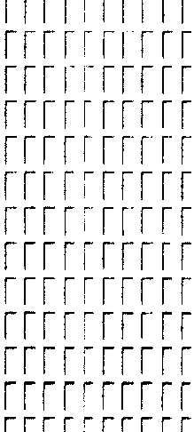

# Real crop examples

These are native crops from the fixed export. The full manifest remains authoritative.
Display width is limited; the image aspect ratio is unchanged.

| Native crop | Printed labels | Data role | Source and box |
| --- | --- | --- | --- |
|  | Siltstone | train; retrospective | `60808400140000_hadrian 2_masterlog_2in_10000-21962`; `[532, 18368, 575, 18392]` |
|  | Shale | train; prospective | `60807402860000_gb506#2_md_mudlog`; `[953, 8982, 1000, 9078]` |
|  | Halite | test; retrospective | `0000000009_d-582_0000020435-0001_log01_fe_1in_md`; `[2983, 61665, 3202, 62151]` |
|  | Clay-shale | test; retrospective | `60811404100000_gc743_dc141_st00bp00_mudlog_1in_md_9209_17052-rev`; `[1244, 19351, 1307, 19454]` |
